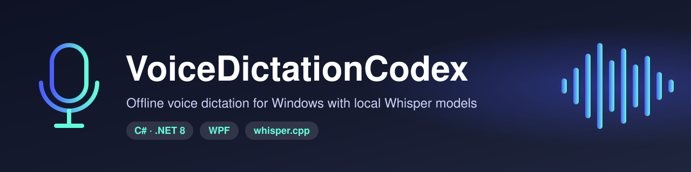
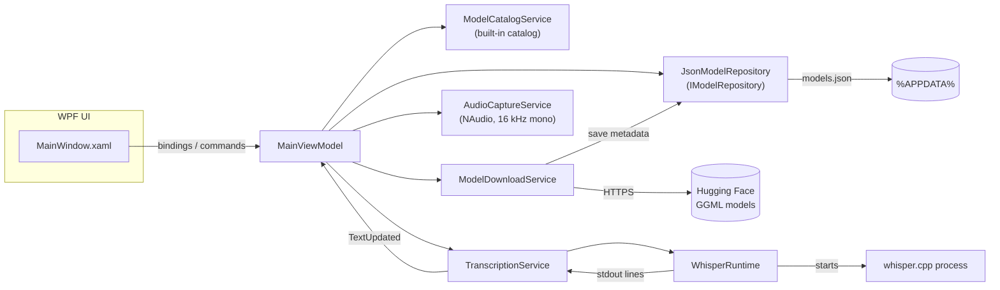

<p align="center">
  
</p>

<p align="center"><strong>Offline voice dictation for Windows with local Whisper models.</strong></p>

<p align="center">
  <a href="LICENSE"></a>
  
  <a href="https://github.com/muhib-karim/VoiceDicatationCodex/actions/workflows/ci.yml"></a>
</p>

---

VoiceDictationCodex is a Windows desktop app (C#, .NET 8, WPF, MVVM) for speech-to-text that runs **entirely on your machine**. It manages local [whisper.cpp](https://github.com/ggerganov/whisper.cpp) GGML models, captures microphone audio with [NAudio](https://github.com/naudio/NAudio), and drives a local Whisper process. Nothing is sent to a cloud speech API, so there is **no API key to configure**.

> **Project status: early prototype.** The UI, model management, persistence and process orchestration are implemented. End-to-end live dictation is **not finished yet**: captured audio is not currently streamed into the Whisper process, and *Import Audio* is a placeholder. See [Roadmap / limitations](#roadmap--limitations).

## Key features

- **Built-in model catalog.** Three whisper.cpp GGML models: `ggml-base.en`, `ggml-small` and `ggml-medium`.
- **Model downloads with progress.** Models stream from the public `ggerganov/whisper.cpp` files on Hugging Face into `Documents\VoiceDictationCodex\Models`, with the percentage shown in the status chip.
- **Local model registry.** Metadata for installed models is saved as JSON in `%APPDATA%\VoiceDictationCodex\models.json` and merged with the catalog at startup.
- **Microphone capture.** 16 kHz mono PCM via NAudio `WaveInEvent`.
- **Whisper runtime orchestration.** Launches an external whisper.cpp executable with the selected model and reads its stdout. JSON lines (`{"text": ...}`) and plain-text output are both accumulated into the live transcript.
- **Session dashboard.** Shows the live transcript, word count, language and model, plus *New Session* and *Export Text* (writes a timestamped `.txt` to `Documents\VoiceDictationCodex`).
- **Dark, custom-styled WPF theme.** Includes rounded buttons and status chips.
- **Graceful failures.** A missing microphone, a missing whisper executable, or a failed download updates the status text instead of crashing the app.

## Quick start

**Prerequisites**

- Windows 10/11
- [.NET 8 SDK](https://dotnet.microsoft.com/download/dotnet/8.0)
- A whisper.cpp command-line binary, if you want to try the runtime integration (see [Configuration](#configuration))

```powershell
git clone https://github.com/muhib-karim/VoiceDicatationCodex.git
cd VoiceDicatationCodex
dotnet restore VoiceDictationCodex.sln
dotnet build VoiceDictationCodex.sln
dotnet run --project src/VoiceDictationCodex.App/VoiceDictationCodex.App.csproj
```

## Usage

1. Pick a model under **Model Library** and click **Download Selected**. The status chip shows download progress.
2. Once the model is installed, click **Start Recording**. This starts microphone capture and the whisper.cpp process. Click **Stop Recording** to end the session.
3. Use **New Session** to clear the transcript and **Export Text** to save it as a `.txt` file.

## Configuration

| Setting | How to set it | Default |
|---|---|---|
| whisper.cpp executable | Environment variable `VOICEDICTATION_WHISPER_PATH` (full path to the binary) | `whisper.cpp.exe`, looked up via the working directory / `PATH` |
| Model download URL | `ModelDownloadService.GetDownloadUrl` | `https://huggingface.co/ggerganov/whisper.cpp/resolve/main/<id>.bin` |

```powershell
$env:VOICEDICTATION_WHISPER_PATH = "C:\tools\whisper.cpp\whisper-cli.exe"
```

No secrets or API keys are used anywhere in the app.

## Architecture

The app follows a lightweight MVVM structure. Views bind to `MainViewModel`, which coordinates plain C# services. More detail is in [`docs/architecture.md`](docs/architecture.md).



## Testing

The test suite is an xUnit project under `tests/` with 18 test cases. It covers the pure logic: the model catalog, JSON model repository round-trips (run against a temporary directory), transcript line parsing, word counting, and whisper runtime argument/executable resolution.

```powershell
dotnet test VoiceDictationCodex.sln --configuration Release
```

GitHub Actions ([`.github/workflows/ci.yml`](.github/workflows/ci.yml)) runs restore, build and test on `windows-latest` with .NET 8 for every push to `main` and every pull request.

## Project structure

```
VoiceDictationCodex.sln
src/VoiceDictationCodex.App/
  App.xaml(.cs)            # WPF application entry point
  Models/                  # WhisperModelInfo record, TranscriptionState
  Services/                # Catalog, download, JSON repository, audio capture, Whisper runtime, transcription
  ViewModels/              # MainViewModel, RelayCommand / AsyncRelayCommand
  Views/                   # MainWindow.xaml
  Resources/Theme.xaml     # Shared colors, brushes and control styles
tests/VoiceDictationCodex.Tests/   # xUnit tests
docs/                      # Architecture notes and banner
```

## Roadmap / limitations

- **Live pipeline:** `AudioCaptureService` already raises audio chunks, but they are not yet passed into the Whisper runtime. The current `--model ... --output-json` arguments are placeholders and need to be matched to the chosen whisper.cpp binary, or replaced with an in-process runtime such as Whisper.NET.
- **Import Audio:** currently shows a placeholder dialog.
- **Session duration:** shown in the UI but not yet updated while recording.
- Planned: waveform visualization, a settings view (hotkeys, formatting, punctuation), and MSIX/WinGet packaging with optional pre-bundled models.

## License

[MIT](LICENSE) © 2026 Muhib Al Karim
