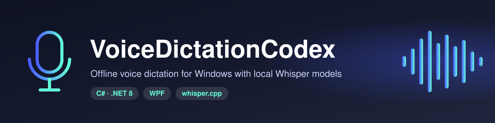
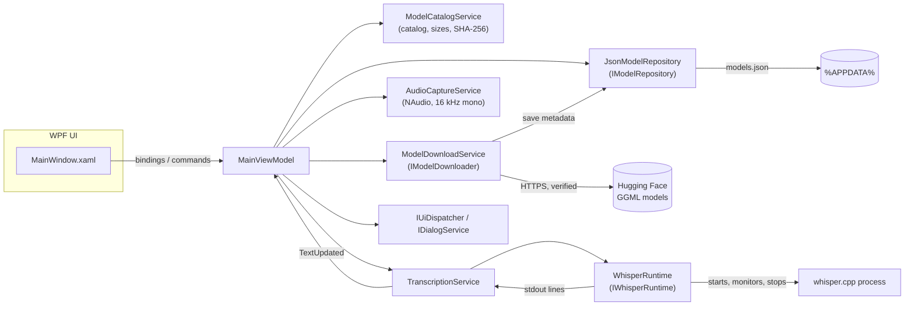

<p align="center">
  
</p>

<p align="center"><strong>Offline voice dictation for Windows with local Whisper models.</strong></p>

<p align="center">
  <a href="https://github.com/muhib-karim/VoiceDicatationCodex/actions/workflows/ci.yml"></a>
  <a href="LICENSE"></a>
  
  
  
  
</p>

---

VoiceDictationCodex is a Windows desktop app (C#, .NET 8, WPF, MVVM) for speech-to-text that runs **entirely on your machine**. It manages local [whisper.cpp](https://github.com/ggerganov/whisper.cpp) GGML models, captures microphone audio with [NAudio](https://github.com/naudio/NAudio), and drives a local Whisper process. Nothing is sent to a cloud speech API, so there is **no API key to configure**.

## Project status: prototype

End-to-end live dictation is **not finished**. Captured audio is not yet passed to the Whisper process, so pressing **Start Recording** does not produce a transcript of what you say.

| Area | State |
|---|---|
| Model catalog, download, SHA-256 verification, local registry | Works |
| Starting, monitoring and stopping an external whisper.cpp process | Works |
| Reading the process output into the transcript view | Works |
| Microphone capture (16 kHz mono PCM, capped at 30 minutes in memory) | Works, but the audio is not consumed yet |
| Feeding captured audio to Whisper (live dictation) | Not implemented |
| Import Audio | Placeholder dialog |
| Session duration | Shown, not updated |

See [Roadmap and limitations](#roadmap-and-limitations).

## Key features

- **Built-in model catalog.** Three whisper.cpp GGML models: `ggml-base.en`, `ggml-small` and `ggml-medium`, each with its exact size and SHA-256.
- **Verified model downloads.** A model streams from the public `ggerganov/whisper.cpp` files on Hugging Face (pinned to one revision) into a `.partial` file. It is moved into place only after its size and SHA-256 match. A failed, stalled or corrupted download leaves nothing behind.
- **Local model registry.** Metadata for installed models is saved as JSON and merged with the catalog at startup. Saves are atomic, and an unreadable file is set aside as `models.json.corrupt` instead of breaking the model list.
- **Cancellable downloads.** *Cancel Download* stops a download in progress, and a connection that stalls for 60 seconds is abandoned.
- **Microphone capture.** 16 kHz mono PCM via NAudio `WaveInEvent`, held in memory with a 30-minute cap.
- **Whisper runtime orchestration.** Launches an external whisper.cpp executable with the selected model, reads stdout and stderr as UTF-8, and reports the exit code and the last stderr lines when the process ends. JSON lines (`{"text": ...}`) and plain-text output are both accumulated into the transcript.
- **Session dashboard.** Shows the transcript, word count, language and model, plus *New Session* and *Export Text* (writes a timestamped `.txt`).
- **Failures stay on screen instead of crashing.** A missing microphone, a missing or exiting whisper executable, a failed download or a failed export updates the status text. Anything unexpected is logged to `%LOCALAPPDATA%\VoiceDictationCodex\logs\errors.log`.
- **Clean shutdown.** Closing the window stops the whisper process, releases the microphone and cancels a running download.
- **Dark, custom-styled WPF theme.**

## Quick start

**Prerequisites**

- Windows 10/11
- [.NET 8 SDK](https://dotnet.microsoft.com/download/dotnet/8.0) (`global.json` pins the 8.0 band)
- A whisper.cpp command-line binary, if you want to try the runtime integration (see [Configuration](#configuration))

```powershell
git clone https://github.com/muhib-karim/VoiceDicatationCodex.git
cd VoiceDicatationCodex
dotnet restore VoiceDictationCodex.sln
dotnet build VoiceDictationCodex.sln
dotnet run --project src/VoiceDictationCodex.App/VoiceDictationCodex.App.csproj
```

## Usage

1. Pick a model under **Model Library** and click **Download Selected**. The status chip shows download progress, and the model is verified before it is marked installed. **Cancel Download** stops it.
2. Once the model is installed, click **Start Recording**. This starts microphone capture and the whisper.cpp process. Click **Stop Recording** to end the session. Until the live pipeline exists, the transcript shows only what the whisper process itself prints.
3. Use **New Session** to clear the transcript and **Export Text** to save it as a `.txt` file.

## Configuration

| Setting | How to set it | Default |
|---|---|---|
| whisper.cpp executable | Environment variable `VOICEDICTATION_WHISPER_PATH` (full path to the binary) | `whisper-cli.exe`, looked up via the working directory / `PATH` |
| Model download URL | `ModelDownloadService.GetDownloadUrl` and `ModelDownloadService.ModelRevision` | `https://huggingface.co/ggerganov/whisper.cpp/resolve/<revision>/<id>.bin` |

```powershell
$env:VOICEDICTATION_WHISPER_PATH = "C:\tools\whisper.cpp\whisper-cli.exe"
```

No secrets or API keys are used anywhere in the app.

## Where data is stored

| Data | Location |
|---|---|
| Downloaded models | `%LOCALAPPDATA%\VoiceDictationCodex\Models` |
| Model registry | `%APPDATA%\VoiceDictationCodex\models.json` |
| Exported transcripts | `Documents\VoiceDictationCodex` |
| Error log | `%LOCALAPPDATA%\VoiceDictationCodex\logs\errors.log` |

Models are kept out of `Documents` so that a synced Documents folder does not upload files of up to 1.5 GB. Models downloaded by an earlier version stay where they are and keep working, because the registry stores their full path.

Captured audio is held in memory only. The app never writes an audio file.

## Model integrity

| Model | Size (bytes) | SHA-256 |
|---|---|---|
| `ggml-base.en` | 147,964,211 | `a03779c86df3323075f5e796cb2ce5029f00ec8869eee3fdfb897afe36c6d002` |
| `ggml-small` | 487,601,967 | `1be3a9b2063867b937e64e2ec7483364a79917e157fa98c5d94b5c1fffea987b` |
| `ggml-medium` | 1,533,763,059 | `6c14d5adee5f86394037b4e4e8b59f1673b6cee10e3cf0b11bbdbee79c156208` |

These values are compiled into `ModelCatalogService` and checked after every download. To add a model, add its id, size and SHA-256 there.

## Architecture

The app follows a lightweight MVVM structure. Views bind to `MainViewModel`, which coordinates plain C# services. More detail is in [`docs/architecture.md`](docs/architecture.md).



## Testing and CI

The xUnit project under `tests/` covers the model catalog, verified downloads (success, hash mismatch, truncation, mid-stream failure, cancellation, stall and HTTP error), the JSON registry (round trips, corrupt files, concurrent saves), transcript line parsing, word counting, the whisper process lifecycle, audio capture (against a fake device), and `MainViewModel` (recording state, downloads, export, disposal, UI-thread marshalling). Process tests launch a small stand-in child process, so they need neither a whisper binary nor a microphone. No test touches the network.

```powershell
dotnet test VoiceDictationCodex.sln --configuration Release
```

GitHub Actions ([`.github/workflows/ci.yml`](.github/workflows/ci.yml)) runs on every push to `main` and every pull request:

- **Build and test** on `windows-latest`: warnings are errors, tests run with coverage, and the coverage figure is written to the job summary.
- **Format and dependency audit**: `dotnet format --verify-no-changes` and a check for known-vulnerable NuGet packages.
- **Secret scan**: gitleaks over the full history.

Actions are pinned by commit SHA, and Dependabot proposes NuGet and action updates weekly.

## Project structure

```
VoiceDictationCodex.sln
src/VoiceDictationCodex.App/
  App.xaml(.cs)            # WPF application entry point
  Models/                  # WhisperModelInfo record, TranscriptionState
  Services/                # Catalog, download, JSON repository, audio capture, Whisper runtime, transcription
  ViewModels/              # MainViewModel, RelayCommand / AsyncRelayCommand
  Views/                   # MainWindow.xaml
  Resources/Theme.xaml     # Shared colors, brushes and control styles
tests/VoiceDictationCodex.Tests/   # xUnit tests
docs/                      # Architecture notes and banner
```

## Roadmap and limitations

- **Live pipeline:** `AudioCaptureService` records audio, but it is not yet passed into the Whisper runtime. The current `--model ... --output-json` arguments are placeholders and need to be matched to the chosen whisper.cpp binary, or replaced with an in-process runtime such as Whisper.NET. With a stock `whisper-cli.exe` the process exits straight away and the app reports its exit code.
- **Import Audio:** currently shows a placeholder dialog.
- **Session duration:** shown in the UI but not yet updated while recording.
- Planned: waveform visualization, a settings view (hotkeys, formatting, punctuation), and MSIX/WinGet packaging with optional pre-bundled models.

## Known issues

Open after the latest round of fixes:

- The model list does not show which models are already installed.
- Recording stops by itself after 30 minutes, because captured audio is held in memory.
- The transcript is rebuilt in full for every new line, which slows down in very long sessions.
- Not yet checked by hand with a real microphone and a real whisper.cpp binary: the audio-device stop sequence, UTF-8 decoding of whisper output, and transcript scrolling. These are covered by automated tests that use stand-ins.

Fixed in that round and no longer issues: transcript updates arriving off the UI thread, the window staying on "Listening" after whisper exits, the whisper process surviving a closed window, downloads that could not be cancelled, **Stop Recording** being disabled by selecting an uninstalled model, deleted model files still showing as installed, unhandled export failures, and the transcript area not scrolling.

## Contributing

Issues and pull requests are welcome. Please keep each pull request focused and say how you tested it. Never commit model files (`*.bin`, `*.gguf`) or audio recordings; `.gitignore` excludes them.

## License

[MIT](LICENSE) © 2026 Muhib Al Karim
